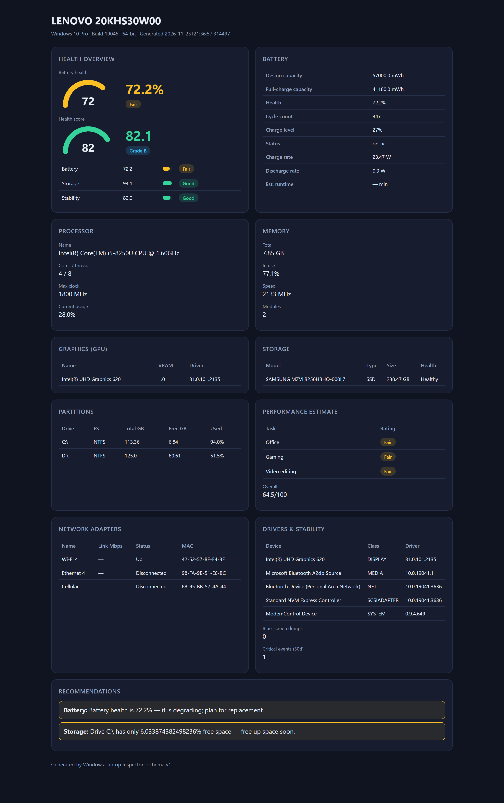
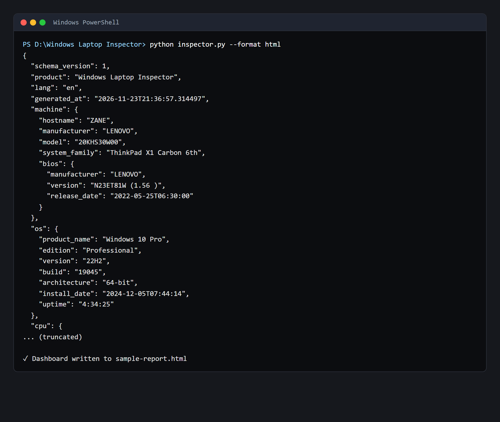

# Windows Laptop Inspector

[](https://github.com/samueljaxon/WindowsLaptopInspector/actions/workflows/release.yml)
[](https://www.virustotal.com/gui/home/upload)
[](https://opensource.org/licenses/MIT)

Inspect a Windows laptop's hardware, software, battery health, and overall condition — then export the result as JSON, HTML, or PDF. Available as a standalone Windows EXE, a Python CLI, and a [DeepSeek Harness](https://github.com/deepseek-ai/deepseek-harness) plugin.

<p align="center">
  
</p>

<p align="center">
  
</p>

## Features

- **Hardware** — CPU, memory, GPU, storage (SSD/HDD media type + SMART health), display, and physical network adapters.
- **Software / OS** — Windows edition, version, build, architecture, BIOS, and key device drivers.
- **Battery** — design vs. full-charge capacity (from `powercfg /batteryreport`), cycle count, live charge/discharge rate in watts, and estimated runtime (from WMI `root\wmi`).
- **Health score** — a 0–100 score (battery + storage + temperature + crash history) with an A–F grade.
- **Performance estimate** — how well the machine handles office work, gaming, and video editing.
- **Recommendations** — plain-language advice in English or Burmese (`--lang my`).
- **Export** — JSON (structured), HTML (interactive dashboard with gauges + bar charts), and PDF (printable).

## Get it

### Option 1 — Windows EXE (no Python required)

Download `WindowsLaptopInspector.exe` from the [latest release](../../releases/latest), then either:

- **Double-click it** — it inspects the machine, writes an HTML dashboard, and opens it in your browser.
- **Run it from a terminal:**

  ```powershell
  WindowsLaptopInspector.exe --format html
  WindowsLaptopInspector.exe --format pdf -o report.pdf
  WindowsLaptopInspector.exe --format json -o report.json
  WindowsLaptopInspector.exe --lang my
  ```

> If the EXE is not yet code-signed, SmartScreen may warn the first time. Click **More info → Run anyway**. Releases are code-signed through SignPath once configured (see below).

### Option 2 — Python

Requires Python 3.8+. `psutil` is optional (used when available; the engine otherwise falls back to pure PowerShell/WMI).

```powershell
python inspector.py                    # JSON report
python inspector.py --format html      # HTML dashboard
python inspector.py --format pdf -o report.pdf
python inspector.py --lang my          # Burmese text
```

### Option 3 — DeepSeek Harness plugin

This repository is also a DSH bundle. Install the local directory from **Plugins → Add plugin**, then ask the agent to *"inspect this laptop"*. See [docs/DETAIL.md](docs/DETAIL.md).

## Build the EXE yourself

```powershell
python -m pip install pyinstaller
pyinstaller --onefile --windowed --icon=assets/icon.ico --name "WindowsLaptopInspector" inspector.py
```

The output is `dist\WindowsLaptopInspector.exe`.

## Releasing

Pushing an annotated `v*` tag triggers [.github/workflows/release.yml](.github/workflows/release.yml), which builds the EXE on `windows-latest` and attaches it to a GitHub Release with the tag message as the release notes:

```powershell
git tag -a v1.0.1 -m "Release notes here"
git push origin v1.0.1
```

## Code signing with SignPath

The release workflow signs `WindowsLaptopInspector.exe` using [SignPath.io](https://signpath.io) (free for open-source projects) before attaching it to the GitHub Release.

### Required repository secrets

Add these under **GitHub → Settings → Secrets and variables → Actions → Repository secrets**:

| Secret | Description |
|---|---|
| `SIGNPATH_API_TOKEN` | An API token for a SignPath user with **submitter** permission on the project / signing policy. |
| `SIGNPATH_ORGANIZATION_ID` | The SignPath organization ID (a GUID). |
| `SIGNPATH_PROJECT_SLUG` | The slug of the SignPath project. |
| `SIGNPATH_SIGNING_POLICY_SLUG` | The slug of the signing policy. |

### How to apply and set up SignPath

1. **Apply for open-source code signing** — create an account at [signpath.io](https://signpath.io) and apply for the free open-source program.
2. **Create an organization** — after approval, create an organization and note its **organization ID** (GUID).
3. **Add the Trusted Build System** — add the predefined *GitHub.com* Trusted Build System to the organization, and install the [SignPath GitHub App](https://github.com/apps/signpath) on this repository.
4. **Create a project** — link it to this repository and note its **project slug**.
5. **Create a signing policy** — note its **signing policy slug**. For open-source signing, use the policy that auto-approves verified public builds.
6. **Create an API token** — create an API token for a user with submitter permission on the project / signing policy.
7. **Store the secrets** — add the four values above as GitHub repository secrets.

> **How it works:** after the EXE is built, the workflow uploads it as a GitHub artifact and submits a signing request to SignPath. The workflow then waits for SignPath to sign and return the artifact, and attaches the signed EXE to the release. **Until the four secrets are configured, tag-triggered release runs fail at the signing step.** The EXE is unsigned until this is set up.

## How it works

The engine (`inspector.py`) shells out to PowerShell, WMI/CIM, and `powercfg` (all built into Windows) and optionally uses `psutil`. Battery capacity and cycle count come from `powercfg /batteryreport`; live charge/discharge rates and voltage come from the WMI `root\wmi` namespace.

| File | Purpose |
|---|---|
| `inspector.py` | Standalone Python inspection engine. |
| `index.js` | DSH Host plugin — registers the `inspect_windows_laptop` agent tool. |
| `client.js` | DSH Client plugin — a composer-dock entry for discoverability. |
| `cordis.patch.yml` | DSH bundle patch. |
| `package.json` | DSH bundle manifest. |
| `locale/`, `docs/`, `icon.svg` | DSH plugin metadata, detail page, and icon. |

## Notes & limitations

- Windows only.
- Battery facts rely on `powercfg /batteryreport`; when that report is unavailable the engine falls back to WMI and reports fewer battery fields.
- Temperature depends on the hardware exposing ACPI thermal zones or an NVIDIA driver; it may be unavailable on some laptops.
- The EXE is unsigned until SignPath code signing is configured; once signed, Windows SmartScreen will not prompt.

## License

[MIT](LICENSE)
